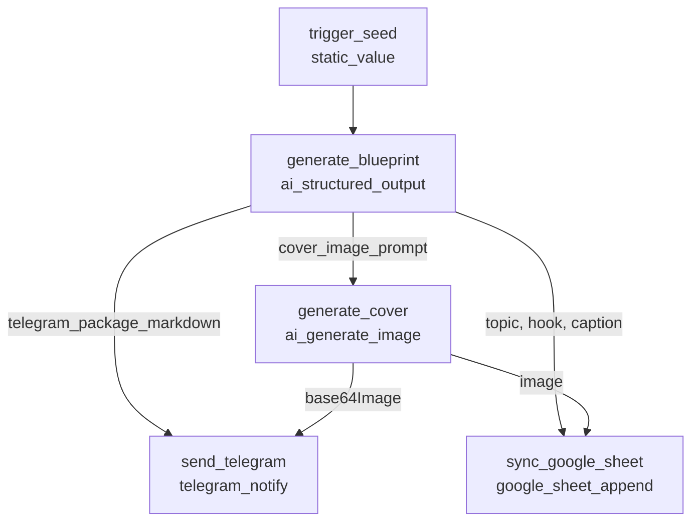
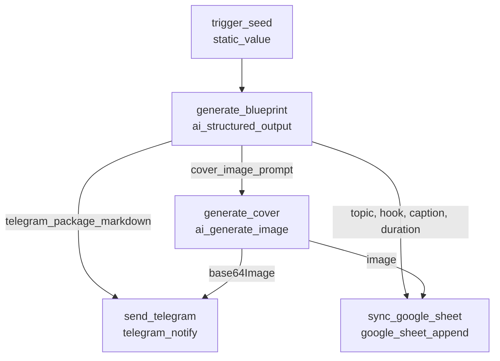

# Personal AI Workflow Orchestrator

A local personal AI workflow automation platform inspired by workflow automation tools such as n8n. The system is designed to run locally, allowing visual creation of workflows, node connection and configuration, local execution, execution history inspection, and AI provider integration.

## Current Scope

The project includes a visual React Flow workflow editor, a deterministic DAG execution engine, MySQL-backed workflow/run persistence, execution history, schedules, inbound webhooks, Gemini and Ollama provider integrations, output guardrails, and controlled HTTP requests.

The platform also runs an automated daily content engine (V0.2) for Telegram & Instagram:
- **Wave 1 (10:00 WIB)**: Morning frontend curation digest + 9:16 pixel art poster.
- **Wave 2 (13:00 WIB)**: Afternoon Instagram blueprint (Reels script, 6-slide carousel copy, captions) + 16-color retro pixel-art cover.
- **Dynamic Style Bank**: Decoupled visual styles in Google Sheets (`Bank_idea_orchestrator_image`), auto-fetched by backend.
- **Color Fidelity**: Deterministic Euclidean color snapping via `sharp`, strict 16-color palette enforcement, and anti-swatch prompt filtering.
- **Editorial Sync**: Automatic logging to Google Sheet Content Calendar (`Sheet1`) with topic rotation countdowns.
- See [docs/WORKFLOW_AUTOMATION.md](docs/WORKFLOW_AUTOMATION.md) for architecture, flowcharts, and operational guide.

The detailed implementation status and phase history are maintained in [docs/PROJECT_PLAN.md](docs/PROJECT_PLAN.md).

---

## Project Structure

```text
Orchestrator-local/
├── .agy/
│   └── skills/           # AI pair programming agent skills and guidelines
├── docs/
│   ├── ARCHITECTURE.md   # Architectural responsibilities and system boundaries
│   ├── DECISIONS.md      # Architecture Decision Records (ADRs)
│   └── PROJECT_PLAN.md   # Phased implementation roadmap
├── backend/              # Node.js + TypeScript REST API backend
│   ├── src/
│   │   ├── config/       # Environment parsing and MySQL connection pool
│   │   ├── controllers/  # API route controllers
│   │   ├── middleware/   # Centralized error handling
│   │   ├── routes/       # Express route definitions
│   │   ├── server.ts     # Express application setup
│   │   └── index.ts      # Server bootstrap entry point
│   ├── .env.example      # Example backend environment variables
│   ├── package.json
│   └── tsconfig.json
├── frontend/             # Next.js + React + TypeScript frontend
│   ├── src/
│   │   ├── app/          # Next.js App Router (layout, dashboard page, styles)
│   │   └── lib/          # API client utilities
│   ├── .env.example      # Example frontend environment variables
│   ├── package.json
│   └── tsconfig.json
├── README.md
└── .gitignore
```

---

## Workflow Mappers (Active DAG Engines)

### Wave 1: Morning Tech Curation (`10:00 WIB`)
Curates fresh frontend web development trends, tips, and beginner-friendly concepts, generates 9:16 pixel art, posts to Telegram, and logs to Google Sheet calendar.



### Wave 2: Afternoon Instagram Content Blueprint (`13:00 WIB`)
Generates complete Instagram package (Reels script, 6-slide carousel copy, captions, hashtags) plus a 16-color pixel-art cover, syncs to Telegram and editorial calendar.



---

## Getting Started

### 1. Backend Setup

```bash
cd backend
npm install

# (Optional) Copy environment template and adjust values if needed
cp .env.example .env

# Run development server with live reload (starts on port 5001)
npm run dev

# Run type check
npm run typecheck

# Build for production
npm run build
```

Health check verification:
```bash
curl http://localhost:5001/api/health
```

### 2. Frontend Setup

```bash
cd frontend
npm install

# (Optional) Copy environment template and adjust values if needed
cp .env.example .env.local

# Run development server (starts on port 3000)
npm run dev

# Run type check
npm run typecheck

# Run linter
npm run lint

# Build for production
npm run build
```
