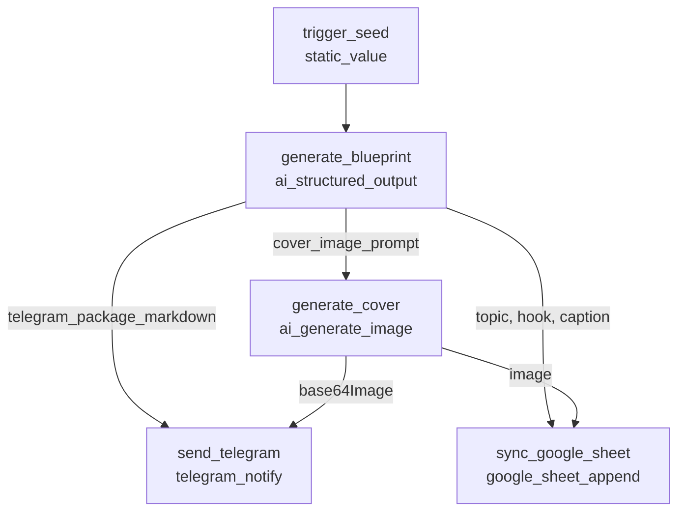
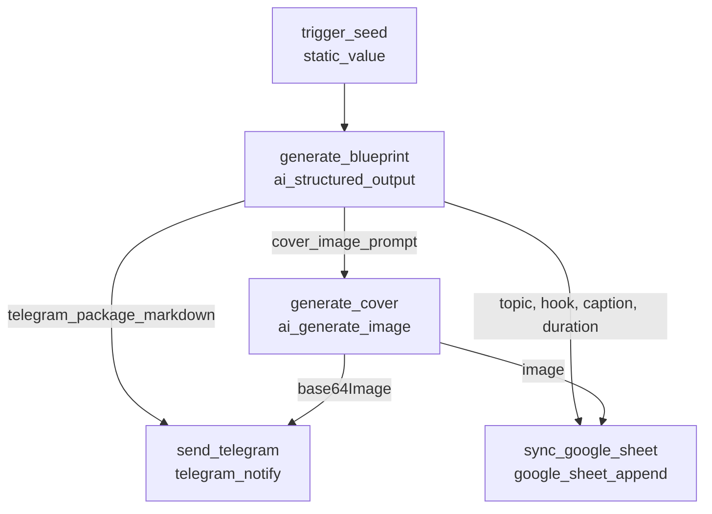

# Daily Content Engine Workflows & Automation Architecture (V0.2)

This document specifies the daily automated content generation engine running on Orchestrator Local, detailing architecture, schedules, workflow DAGs, dynamic style banking via Google Sheets, post-processing palette snapping, and dual-channel delivery.

---

## 1. System Architecture (v0.2)

The engine runs as a zero-touch local background service on macOS managed by `launchd` (`com.orchestrator.backend`) on port `5001`.

```
                  ┌──────────────────────────────────────────────┐
                  │          macOS launchd Daemon Service        │
                  │            (com.orchestrator.backend)        │
                  └──────────────────────┬───────────────────────┘
                                         │
                                         ▼
                           ┌───────────────────────────┐
                           │    SchedulerService       │
                           │ (Polls MySQL every 5s)    │
                           └─────────────┬─────────────┘
                                         │
                 ┌───────────────────────┴───────────────────────┐
                 │                                               │
                 ▼ (10:00 WIB daily)                             ▼ (13:00 WIB daily)
   ┌───────────────────────────┐                   ┌───────────────────────────┐
   │          Wave 1           │                   │          Wave 2           │
   │  Morning Tech Curation    │                   │  IG Blueprint & Pixel Art │
   └─────────────┬─────────────┘                   └─────────────┬─────────────┘
                 │                                               │
                 ├─► Google Gemini (gemini-3.8-flash)            ├─► Google Gemini (gemini-3.8-flash)
                 │   [Direct primary API]                        │   [Direct primary API]
                 │   └─► Fallback: 9Router (cx/gpt-6-luna)       │   └─► Fallback: 9Router (cx/gpt-6-luna)
                 │                                               │
                 ├─► Google Sheet Style Bank                     ├─► Google Sheet Style Bank
                 │   (Bank_idea_orchestrator_image via doGet)    │   (Bank_idea_orchestrator_image via doGet)
                 │                                               │
                 ├─► 9Router Antigravity (ag/gemini-3.1-flash)   ├─► 9Router Antigravity (ag/gemini-3.1-flash)
                 │   └─► sharp post-process: Palette snapping   │   └─► sharp post-process: Palette snapping
                 │                                               │
                 ├─► Telegram Delivery (@orchestlocalbot)        ├─► Telegram Delivery (@orchestlocalbot)
                 │                                               │
                 └─► Google Sheet Calendar Sync                  └─► Google Sheet Calendar Sync
                     (Sheet1: Date, Topic, Hook, Status, Dur)        (Sheet1: Date, Topic, Hook, Status, Dur)
```

---

## 2. Schedule & Catch-up Specification

| Wave | Trigger Time | Timezone | Trigger ID | Idempotency Pattern | Catch-up on Boot |
| :--- | :--- | :--- | :--- | :--- | :--- |
| **Wave 1** | `10:00` WIB | `Asia/Jakarta` | `trig_1791725306314_g2htpb` | `wave_1_morning_curation_daily_YYYYMMDD_1000` | Yes (`catchUp: true`) |
| **Wave 2** | `13:00` WIB | `Asia/Jakarta` | `trig_1791729323362_dtv06q` | `wave_2_afternoon_blueprint_daily_YYYYMMDD_1300` | Yes (`catchUp: true`) |

- **Exact once per day**: The scheduler enforces deterministic idempotency keys formatted with the current date. If already run for today's slot, it will not fire again.
- **Catch-up on boot**: If the computer was asleep during the trigger hour, the scheduler immediately executes the missed run upon wake/boot.

---

## 3. Workflow DAG Details

### Wave 1: Morning Tech Curation (`wave_1_morning_curation`)
Curates fresh frontend web development trends, tips, and beginner-friendly concepts, generates 9:16 pixel art, posts to Telegram, and logs to Google Sheet calendar.



### Wave 2: Afternoon Instagram Content Blueprint (`wave_2_afternoon_blueprint`)
Generates complete Instagram package (Reels script, 6-slide carousel copy, captions, hashtags) plus a 16-color pixel-art cover, syncs to Telegram and editorial calendar.



---

## 4. Visual Identity & Dynamic Style Banking

### A. Google Sheet Style Bank (`Bank_idea_orchestrator_image`)
Styles are decoupled from code. Designers define styles in Google Sheet; the backend fetches active rows dynamically on each generation run via Google Apps Script `doGet`.

| Column | Name | Purpose | Example |
| :--- | :--- | :--- | :--- |
| **A** | `Style Name` | Identifier | `Pixel Navy`, `Muted Earthy Retro` |
| **B** | `Active` | Switch flag (`TRUE`/`FALSE`) | Top `TRUE` row is used automatically |
| **C** | `Color Palette` | Approved 16 hex codes | `#e1b670, #b96925, ... #000000` |
| **D** | `Color Distribution` | Role & percentage usage | Background ~50%, Headline gold, panels teal |
| **E** | `Composition & Perspective` | Layout, zones, margins | Top 25% headline, mid 40% cards, bot 35% character |
| **F** | `Strict Rules` | Negative constraints | No gradients, no swatches, no anti-aliasing |

### B. Anti-Swatch Prompt Filter & Exact Palette Snapping
1. **Natural-language translation**: Hex codes are automatically converted to descriptive color names (e.g. `#001437` -> `dark navy`) before hitting the diffusion model. This eliminates the "pink elephant" artifact where models draw swatch bars when hex codes or the word "palette" appear in prompts.
2. **Deterministic Palette Snapping (`sharp`)**:
   Post-generation, `backend/src/nodes/ai/image/style.ts` maps every pixel of the output image to the exact nearest Euclidean color in the active 16-color palette. 100% color-space fidelity is mathematically guaranteed.

---

## 5. Editorial Calendar Schema (`Sheet1`)

The `google_sheet_append` action appends generated content rows automatically:

| Col | Field | Source | Example |
| :---: | :--- | :--- | :--- |
| **A** | `Date` | Timestamp | `2026-10-15T11:50:54.054Z` |
| **B** | `Wave` | Config / Input | `Wave 2 (Afternoon Blueprint)` |
| **C** | `Topic` | `topic_title` | `LocalStorage Browser (Skor Game)` |
| **D** | `Hook` | `reels_script.hook_3s` | `Kenapa data web hilang pas di-refresh?` |
| **E** | `Caption` | `instagram_caption` | Full body copy + 15 hashtags |
| **F** | `Image` | `imageUrl` / Base64 marker | `generated_pixel_art.png` |
| **G** | `Status` | Editorial state | `Ready` (Manual review -> `Posted`) |
| **H** | `Duration` | Cadence tracker | `Day 2/3 (Rotate in 1 day)` |

---

## 6. Resilience & Model Fallback

- **Text Primary**: `gemini-3.8-flash` via direct Google Generative AI API (best Indonesian tone and zero proxy latency).
- **Text Backup**: Automatic failover to `cx/gpt-6-luna` via 9Router if Gemini quota is exhausted or HTTP 5xx occurs.
- **Image Primary**: `ag/gemini-3.1-flash-image` via 9Router Antigravity proxy.
- **Style Fallback**: If Google Sheet is unreachable or times out (>20s), the system defaults gracefully to built-in `Pixel Navy` without failing the workflow.

---

## 7. Operations & Daemon Management

- **Restart Service**:
  ```bash
  launchctl kickstart -k gui/$(id -u)/com.orchestrator.backend
  ```
- **Run Tests**:
  ```bash
  cd backend && npm test
  ```
- **View Live Logs**:
  ```bash
  tail -f backend/logs/backend.stdout.log
  tail -f backend/logs/backend.stderr.log
  ```
