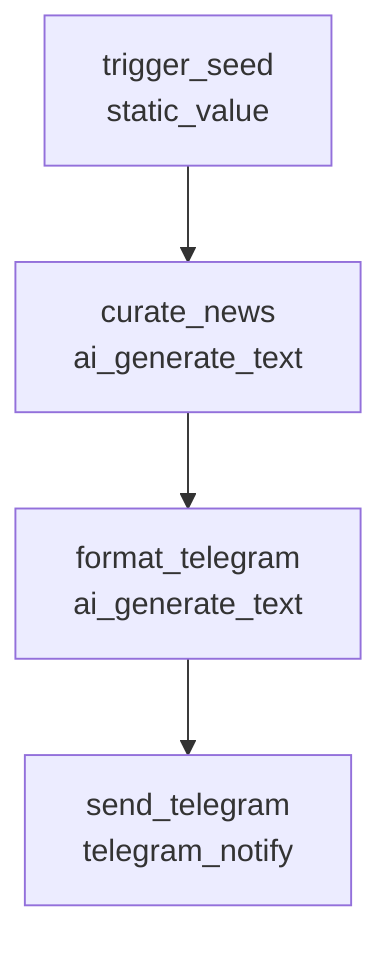
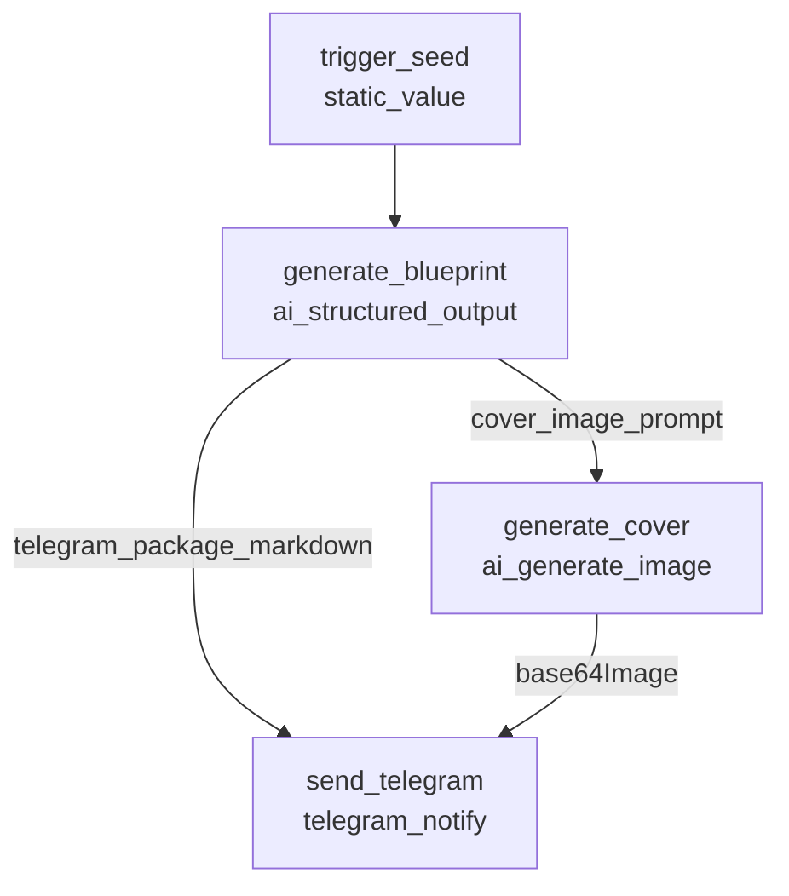

# Daily Content Engine Workflows & Automation Architecture

This document specifies the daily automated content generation engine running on Orchestrator Local, detailing architecture, schedules, workflow DAGs, flowchart, and delivery integration.

---

## 1. System Architecture

The engine runs as a zero-touch local background service on macOS managed by `launchd` (`com.orchestrator.backend`) on port `5001`.

```
                  ┌──────────────────────────────────────────────┐
                  │          macOS launchd Daemon Service        │
                  │            (com.orchestrator.backend)        │
                  └──────────────────────┬───────────────────────┘
                                         │
                                         ▼
                           ┌───────────────────────────┐
                           │    SchedulerService       │
                           │ (Polls MySQL every 5s)    │
                           └─────────────┬─────────────┘
                                         │
                 ┌───────────────────────┴───────────────────────┐
                 │                                               │
                 ▼ (10:00 WIB daily)                             ▼ (13:00 WIB daily)
   ┌───────────────────────────┐                   ┌───────────────────────────┐
   │          Wave 1           │                   │          Wave 2           │
   │  Morning Tech Curation    │                   │  IG Blueprint & Pixel Art │
   └─────────────┬─────────────┘                   └─────────────┬─────────────┘
                 │                                               │
                 │ Google Gemini                                 ├─► Google Gemini (Text & Schema)
                 │ (gemini-2.5-flash)                            │   (gemini-2.5-flash)
                 │                                               │
                 │                                               └─► 9Router Antigravity Proxy
                 │                                                   (ag/gemini-3.1-flash-image)
                 │                                               │
                 ▼                                               ▼
   ┌───────────────────────────┐                   ┌───────────────────────────┐
   │    Telegram Delivery      │                   │    Telegram Delivery      │
   │      (Digest Text)        │                   │    (Photo + Blueprint)    │
   └─────────────┬─────────────┘                   └─────────────┬─────────────┘
                 │                                               │
                 └───────────────────────┬───────────────────────┘
                                         ▼
                           ┌───────────────────────────┐
                           │   User Telegram Client    │
                           │   (@orchestlocalbot)      │
                           └───────────────────────────┘
```

---

## 2. Schedule & Catch-up Specification

| Wave | Trigger Time | Timezone | Trigger ID | Idempotency Pattern | Catch-up on Boot |
| :--- | :--- | :--- | :--- | :--- | :--- |
| **Wave 1** | `10:00` WIB | `Asia/Jakarta` | `trig_1791725306314_g2htpb` | `wave_1_morning_curation_daily_YYYYMMDD_1000` | Yes (`catchUp: true`) |
| **Wave 2** | `13:00` WIB | `Asia/Jakarta` | `trig_1791729323362_dtv06q` | `wave_2_afternoon_blueprint_daily_YYYYMMDD_1300` | Yes (`catchUp: true`) |

- **Exact once per day**: The scheduler enforces deterministic idempotency keys formatted with the current date. If already run for today's slot, it will not fire again.
- **Catch-up on boot**: If the computer was asleep during the trigger hour, the scheduler immediately executes the missed run upon wake/boot.

---

## 3. Workflow DAG Details

### Wave 1: Morning Tech Curation (`wave_1_morning_curation`)
Curates fresh frontend web development trends, tips, and beginner-friendly concepts.



- **Nodes**:
  1. `trigger_seed`: Injects target niche (`frontend web development, React, Next.js, modern web standards`).
  2. `curate_news`: Queries Gemini for 3 top educational insights/updates.
  3. `format_telegram`: Formats the curation into mobile-ready Telegram Markdown.
  4. `send_telegram`: Delivers text message to Telegram channel/DM with message chunking (>4000 chars) and plaintext fallback.

---

### Wave 2: Afternoon Instagram Content Blueprint & Pixel Art (`wave_2_afternoon_blueprint`)
Generates a complete Instagram package (Reels script, 6-slide carousel copy, captions, hashtags) plus a 16-color pixel-art cover.



- **Nodes**:
  1. `trigger_seed`: Injects audience theme (`frontend web development & coding for beginners and kids, educational and fun`).
  2. `generate_blueprint`: Structured JSON generation producing:
     - `topic_title`
     - `reels_script` (hook, visual cues, voiceover)
     - `carousel` (5–7 slides with Figma-ready copy)
     - `instagram_caption` (caption body + hashtags)
     - `cover_image_prompt` (rigorously constrained 16-color pixel art prompt)
     - `telegram_package_markdown` (Figma/CapCut ready Markdown)
  3. `generate_cover`: Generates 16-bit retro arcade pixel-art cover image via 9Router proxy (`ag/gemini-3.1-flash-image`).
  4. `send_telegram`: Sends photo attachment along with full text blueprint in a single coordinated Telegram delivery.

---

## 4. Visual Identity & Pixel Art System

The image generation node applies a strict 16-color retro video game design system:

```text
Approved 16-Color Hex Palette:
#e1b670 | #b96925 | #68392e | #201300
#404e21 | #45944f | #77d3b2 | #96bfff
#038ac2 | #01515e | #001437 | #503e66
#a762a9 | #efa3c8 | #ffffff | #000000
```

- **Canvas Background**: Solid dark navy `#001437`.
- **Negative Constraints**: Zero gradients, zero blur, zero glow, zero anti-aliasing.
- **No Palette On Canvas**: Strict ban on color swatch boxes, palette bars, or hex text rendered on the image. Palette is applied strictly to shade artwork and typography.
- **Typography**: Blocky arcade bitmap lettering with black outline.
- **Composition**: Zoned 3-part layout (Top headline, Middle concept cards, Lower workspace illustration).

---

## 5. Operations & Daemon Management

- **Start Daemon**:
  ```bash
  launchctl bootstrap gui/$(id -u) ~/Library/LaunchAgents/com.orchestrator.backend.plist
  ```
- **Restart Daemon**:
  ```bash
  launchctl kickstart -k gui/$(id -u)/com.orchestrator.backend
  ```
- **Stop Daemon**:
  ```bash
  launchctl bootout gui/$(id -u)/com.orchestrator.backend
  ```
- **View Logs**:
  ```bash
  tail -f /Users/aufaalfirdausi/Developer/automatic-content/Orchestrator-local/backend/logs/backend.stdout.log
  tail -f /Users/aufaalfirdausi/Developer/automatic-content/Orchestrator-local/backend/logs/backend.stderr.log
  ```
